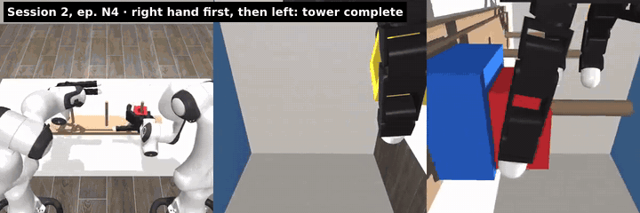
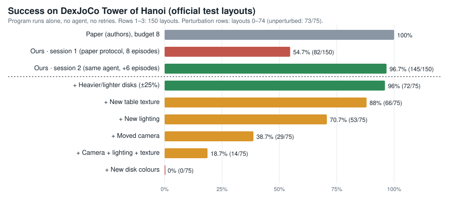
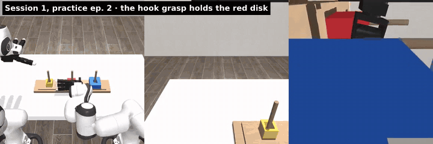
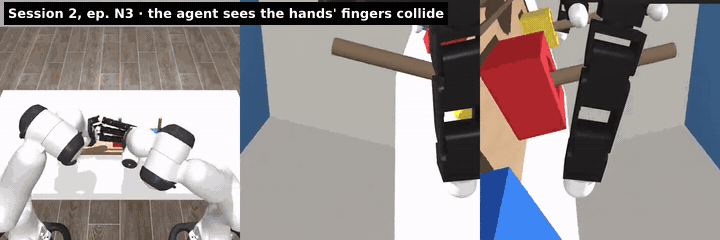
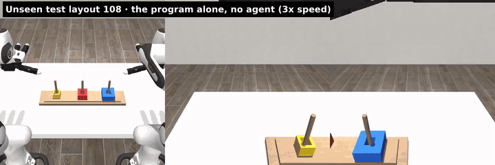
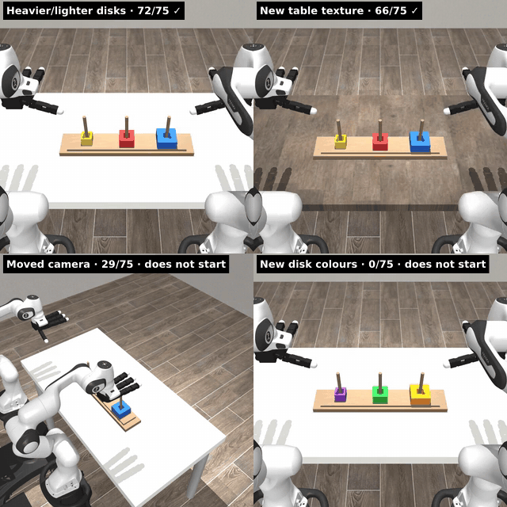

<div align="center">

# Reproducing RaX on Tower of Hanoi

**Can a robot-agent paper be reproduced from what its authors released, and how robust is the program its agent writes?**

[](https://arxiv.org/abs/2610.22496)
[](https://github.com/robot-agent-exploration/rax)
[](https://robot-agent-exploration.com/)




<sub>The agent's second session completes the tower with the grasp it worked out itself: right hand first, then left. Left: third-person view; middle and right: wrist cameras.</sub>

</div>

---

## The short answers

| Question | Answer |
|---|---|
| **Did the authors share the prompts?** | ✅ **Yes, all of them.** Their own render script regenerates every recorded prompt byte for byte. The agent gets a 2-line start message plus a workflow file, a task file and 25 skill files. |
| **Does the released code run?** | ✅ **Yes, end to end.** With no changes to the agent's prompts, tools or evaluation, the agent explored, wrote a 1,064-line Python controller, rehearsed it and submitted it. The program then ran alone on the 150 official test layouts. |
| **Do we get the paper's number?** | 🟨 **Close, with more practice.** The paper reports 100% at an 8-episode budget. Our first session under their protocol: **54.7%**. The same agent after 6 more practice episodes: **96.7%**. |
| **Is the program robust?** | 🟨 **To physics, yes; to looks, not yet.** Heavier/lighter disks: 96%. New table texture: 88%. Big changes of camera or disk colour stop it, because it only ever practised on one view. A fair test (practice on visually varied scenes) is [running](#whats-running). |

<p align="center"></p>

## What RaX is, in one paragraph

[RaX](https://arxiv.org/abs/2610.22496) does not train a policy. A frozen coding agent (Claude Code with Opus 5.5) gets a robot through tools (observe, move, check the task) and a budget of practice episodes. It solves the task by hand, writes notes, and then **compiles what worked into a Python program**, `controller.py:main(ctx)`, that runs the task without the agent. That program is the "policy" that gets scored, on layouts it never saw.

## What the agent figured out

<table>
<tr>
<td width="50%"><br><b>1 · The hook grasp works.</b> A straight pinch is narrower than the disk, so the agent designs a "hook": the index wraps the far side while the thumb presses the near side. The red disk lifts and stays.</td>
<td width="50%"><br><b>2 · It spots why the grasp still slips.</b> From its own wrist-camera frames it sees that when both hands close at once, the left hand's fingers block the right index finger.</td>
</tr>
<tr>
<td width="50%"><br><b>3 · One hand at a time.</b> Right hand grasps first and curls its spare fingers aside, then the left hand grasps. The first complete tower.</td>
<td width="50%"><br><b>4 · The program alone, unseen layout.</b> No agent, no retries: the compiled controller completes test layout 108. It now holds its right-hand grasp first try on <b>150/150</b> test layouts.</td>
</tr>
</table>

## What we did, step by step

| # | Step | Result | Claude cost |
|---|---|---|---|
| 1 | Set up the authors' `dexjoco/native` branch on a SLURM cluster; verified prompts against their recorded fingerprints | ✅ identical; one fix needed: newer `bubblewrap` for the sandbox | $0 |
| 2 | **Session 1**: their protocol exactly (8 practice episodes, empty workspace, 3 photos of the finished tower) | Program submitted after 1 successful rehearsal | $34.08 |
| 3 | Scored that program on the 150 official layouts | **82/150 (54.7%)**, seeds 56/54/54% · most misses at the right hand's first grasp | $0 |
| 4 | **Session 2**: the same agent continued for 6 more practice episodes on new layouts *(beyond the paper's protocol)* | Found the "one hand at a time" grasp; 2/2 rehearsals passed | +$20.59 |
| 5 | Scored the new program on the same 150 layouts | **145/150 (96.7%)**, seeds 96/96/98% | $0 |
| 6 | Changed the scene one factor at a time (75 layouts each) | See the robustness table below | $0 |
| 7 | **Session 3**: practice on visually randomized scenes (the fair test for appearance) | Submitted; 150-layout test running | +$6.84 so far |

## Robustness: one change at a time

The same program, the same first 75 official layouts (unperturbed: **73/75**), one change at a time. Every perturbed run has an unperturbed twin.

<p align="center"></p>

| Change | Kind | Success | Reading |
|---|---|---:|---|
| Each disk 25% heavier or lighter | physics | **72/75** | ✅ handles it |
| Random table texture (e.g. red wood) | appearance | **66/75** | ✅ mostly handles it |
| Random lighting | appearance | **53/75** | 🟨 not practised yet |
| Third-person camera moved | viewpoint | **29/75** | 🟨 not practised yet |
| Camera + lighting + texture together | appearance | **14/75** | 🟨 not practised yet |
| Disks recoloured (same sizes) | task understanding | **0/75** | 🟨 not practised yet |

**Why "not practised yet" and not "fails":** in standard Hanoi practice, the camera, lighting and disk colours never change, so the agent tuned colour thresholds for the one view it saw. Our runs also had **no Gemini** (the paper's vision-language tool), and the authors' own published Hanoi program does not call it either. The task names the disks by size ("medium", "small"), so a program that found them by size would pass the colour test. The fair question is what the agent writes when it *does* practise on varied scenes. That is session 3.

## What's running

- **Session 3 (adaptation to `bimanual_hanoi_random`)**: the same agent, 6 practice episodes where camera, lighting and table texture change every episode, no Gemini. Its program is being scored on 150 randomized layouts; the comparison point is the session-2 program's **14/75** on that setting. This README will be updated with the result.

## Repository layout

```
README.md                  this page
media/                     GIFs and the score chart (all from our own runs)
results/summary.json       every number on this page, generated from the run files
docs/report/               the full interactive report (open index.html locally): videos synced with what the agent was doing
notes/                     verified notes: what is released, paper claims vs evidence, both sessions, the programs, the run manifest
patches/                   our only change to the authors' harness: opt-in perturbation hooks (RAX_PERTURB), off by default
tools/                     spend watcher, run parser, clip/GIF/chart builders, source-copy helper for parallel re-scoring
jobs/                      SLURM templates and launchers used on the cluster
prompts/RERUN_PROMPT.md    a detailed, context-rot-resistant prompt to rerun the whole experiment (v2)
```

## Reproducing this

1. Clone [robot-agent-exploration/rax](https://github.com/robot-agent-exploration/rax) and check out `origin/dexjoco/native` (commit `bcd748c`). Follow its `docs/SETUP.md`. On older clusters install `bubblewrap>=0.9` and `socat` from conda-forge into the harness env.
2. Run a session:
   ```bash
   runtime/envs/host/bin/python scripts/configure_auto_research.py --task bimanual_hanoi --sim-gpu 0 \
       --episodes 8 --agent-cli claude --agent-provider anthropic --agent-effort xhigh
   bash scripts/start_auto_research_agent.sh --config runtime/auto-research/<id>/operator-input.json \
       --non-interactive --claude-key-file <key file>
   ```
3. For perturbations, apply `patches/0001-dexjoco-perturbation-hooks.patch` and re-score a frozen bundle with `RAX_PERTURB=<mass|texture|lighting|camera|rand_full|colors_new>` and `python -m services.controller.parallel_batch --source-session <session> --bundle <id> --episodes 75`.
4. `prompts/RERUN_PROMPT.md` contains every pitfall we hit and its fix.

## Caveats

- **One task.** The paper covers dozens of tasks across five benchmarks; we tested one.
- **Sessions 2 and 3 go beyond the paper's protocol**, which always starts from an empty workspace. 54.7% is the faithful number.
- **One session per setting**, like the paper. The gap between our sessions suggests the spread between sessions is large; the paper does not measure it.
- **Closed models change over time**, so an exact rerun is impossible even with identical code.
- Setup differences: Claude Code 2.1.303 (authors tested 2.1.296), no Gemini key, a newer `bubblewrap`.
- Activity logs in the report are reconstructed from the agent's visible messages, tool calls and notes; its private reasoning is not stored.

## Credits

RaX, its harness, prompts and skills are by the authors of [arXiv 2610.22496](https://arxiv.org/abs/2610.22496) ([code](https://github.com/robot-agent-exploration/rax), Apache-2.0). DexJoCo is by its authors ([brave-eai/dexjoco](https://github.com/brave-eai/dexjoco)). This repository only contains our scripts, notes, results and media from our own runs.
