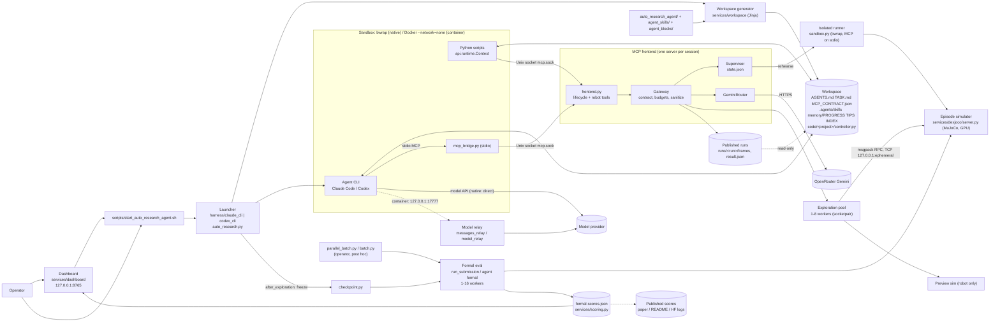

# RaX system architecture (for a diagram)

All evidence comes from `git show` / `git grep` on remote branches. Nothing was checked out or run.
Citations use `branch:path:line`. `N` = `origin/dexjoco/native`, `C` = `origin/dexjoco/container`,
`F` = `origin/real/franka`, `main` = the working tree on main.

## 0. Key correction to the component list

On the sim branches there are **no separate perception, control, Gemini or operator MCP servers**.
Each session has **one MCP server**, the "MCP frontend" (`services/controller/frontend.py`). It
serves lifecycle tools, robot tools (perception and control) and `gemini_generate` on a single Unix
socket (N:docs/ARCHITECTURE.md:51, N:services/controller/frontend.py:1).
- "Gemini router" is a class inside that server: `GeminiRouter` (N:services/controller/gemini.py:184), imported by the frontend (N:services/controller/frontend.py:22).
- "Perception" and "control" are tool groups that the backend registers, e.g. `dexjoco_observe`, `dexjoco_step`, `dexjoco_hold` and pixel-to-position (N:docs/ARCHITECTURE.md:214-217). They are not separate processes.
- "Operator" as an MCP tool (`request_operator`) exists only on the real-robot branches, both real/franka (F:services/controller/operator.py:1-9) and real/rainbow (origin/real/rainbow:services/controller/operator.py) [corrected]. On sim branches the operator is a human who uses the dashboard and scripts (N:docs/ARCHITECTURE.md:27-28).
- Model relays (`harness/claude_cli/messages_relay.py`, `harness/codex_cli/model_relay.py`) exist **only on the container branches** (C) and on the real branches (`F:harness/claude_cli/messages_relay.py`). On native branches the CLI calls its provider directly (N:docs/ARCHITECTURE.md:37-39, 92).

## 1. Components

| # | Component | What it is | Process / port boundary | Implemented in | Data in / out |
|---|---|---|---|---|---|
| 1 | Operator launcher | Prepares the workspace and CLI home, starts the MCP frontend and then the agent CLI. Relaunches and resumes the agent. Runs freeze and formal evaluation after the agent exits | Host Python process, one per session (N:docs/ARCHITECTURE.md:63-68) | N:harness/claude_cli/auto_research.py, N:harness/codex_cli/auto_research.py (N:docs/ARCHITECTURE.md:48). Entry point: N:scripts/start_auto_research_agent.sh | Reads the immutable `configuration.json` (N:docs/ARCHITECTURE.md:286-291). Writes `settings.json` and `mcp.json` (N:harness/claude_cli/auto_research.py:227-234). Calls `after_exploration` (N:services/agent_formal/checkpoint.py:96-125) |
| 2 | Agent CLI | Claude Code or Codex CLI with a frozen model. It reasons, calls MCP tools, edits files and runs Bash/Python | **Native:** host process running as the user, with its own home (`claude-home/`, `codex-home/`) (N:docs/ARCHITECTURE.md:92-98). **Container:** runs inside a Docker container (C:docs/ARCHITECTURE.md:90-97; image C:services/controller/agent_runtime.Dockerfile) | Command line built in N:harness/claude_cli/auto_research.py:256-272 (`--mcp-config`, `--strict-mcp-config`, `--disallowedTools`, `--resume`). Environment in N:harness/agent_host.py | MCP JSON-RPC over stdio to the bridge. Model calls go to the provider (native) or the relay (container) |
| 3 | Sandbox | Native: the CLI's own sandbox. For Claude Code that is the `sandbox` block in settings.json (bubblewrap and socat). For Codex it is a permission profile. Rules: writes only to the workspace and the socket directory, no network, no GPU, and the repo, other sessions and credentials are hidden. Container: `--network=none`, read-only root, no GPU, 16 GiB / 4 CPU, workspace on a capped ext4 image | Kernel namespaces around every command the agent runs | N:harness/claude_cli/auto_research.py:197-224, N:harness/codex_cli/auto_research.py:269-305, N:harness/agent_host.py:24-56. Rules described in N:docs/ARCHITECTURE.md:104-144. Container version: C:harness/codex_cli/workspace_storage.py and `agent_runtime.Dockerfile` | Mounts: `/workspace` read-write, `runtime/autonomous_controller` (published runs) read-only, the robot socket |
| 4 | Model relay (container and real branches only) | A transparent HTTP relay on the host. It adds the credential, enforces a model allowlist, retries 429/5xx for up to 600 s and counts calls in `model-calls.json` | Inside the container, the CLI uses `http://127.0.0.1:17777` (C:harness/codex_cli/container_bridge.py:50). `container_bridge.py` forwards that to a host Unix socket under `/run/agent-relay` | C:harness/claude_cli/messages_relay.py:1-14 (Anthropic Messages, via OpenRouter, an Anthropic API key, or a `claude-login` setup-token account [corrected]), C:harness/codex_cli/model_relay.py:1 (Responses). Base URL set in C:harness/claude_cli/auto_research.py:97 and C:harness/codex_cli/auto_research.py:204 | Requests and responses pass through unchanged except the credential. Provider endpoints are listed in C:harness/claude_cli/messages_relay.py:10-12 |
| 5 | MCP bridge | A small stdio MCP server that the CLI starts. It pipes bytes to the session socket | A stdio child of the CLI, connected to the Unix socket `<session>/…/mcp.sock` (N:harness/agent_host.py:56). The socket path is in env `RAX_MCP_SOCKET` (N:harness/agent_host.py:24) | N:harness/mcp_bridge.py:1-30. Registered as `{'type':'stdio','command':python,'args':['-I',BRIDGE,socket]}` (N:harness/claude_cli/auto_research.py:232-234). The container equivalent is C:harness/codex_cli/container_bridge.py:11 | Raw MCP JSON-RPC frames |
| 6 | Development Python `Context` | Lets agent scripts and `controller.py:main(ctx)` call the same tools (`ctx.call(...)`, `ctx.env(i)`) | Inside the agent sandbox, connecting to the same Unix socket (N:auto_research_agent/api/runtime.py:54-56) | N:auto_research_agent/api/runtime.py. Usage described in N:docs/ARCHITECTURE.md:259-273 | MCP calls. The frontend multiplexes up to 16 clients and serializes calls (N:docs/ARCHITECTURE.md:271-273; N:services/controller/frontend.py:503 is only `listener.listen(16)`, a connection backlog, not a client cap [corrected]) |
| 7 | MCP frontend (single MCP server) | Defines the tools for the current phase and dispatches lifecycle tools (`status`, `start_episode`, `evaluate`, `finish`, `register`, `rehearse`, `submit`), robot tools and `gemini_generate` | Host process `services.controller.frontend --socket`, bound to a 0600 Unix socket (N:services/controller/frontend.py:499-503). It outlives agent runs (N:harness/mcp_bridge.py:3-5) | N:services/controller/frontend.py:87-92 (tool definitions), :249-330 (dispatch). The contract is in N:services/mcp_contract.py (N:docs/ARCHITECTURE.md:189-200) | Replies are a JSON text block plus PNG image blocks: RGB, and uint16 depth in mm (N:docs/ARCHITECTURE.md:221-225) |
| 7a | Gateway | Admits only the tools in the contract, charges budgets, strips private fields (`seed`, `layout_id`, `sim_port`, …) and publishes frame sequences | In-process in the frontend | N:services/controller/gateway.py:1, :19-24 (`PRIVATE`, `sanitized`), :58 | Removes reward, seeds and layout IDs from replies. Only `episode_ended` and the binary `task_complete` are disclosed (N:docs/ARCHITECTURE.md:227-229) |
| 7b | Supervisor | Owns `state.json`: episodes, budgets, bundles, rehearsals, the submission and formal batches | In-process in the frontend. It is also used after the agent exits, by `after_exploration` (N:services/agent_formal/checkpoint.py:112) | N:services/controller/supervisor.py:131. Methods: `register` :381, `start_interactive` :414, `finish_interactive` :456, `run` :533, `submit` :549, `run_submission` :567, `_run_parallel_formal` :772 | Writes `formal-scores.json` / `agent-formal-scores.json` (N:services/controller/supervisor.py:36-38) |
| 7c | Gemini router | A host-held OpenRouter key and `google/gemini-3.8-flash`, with one nanodollar ledger per session | In-process in the frontend. Outbound HTTPS to `openrouter.ai` (N:services/controller/gemini.py:15-16) | N:services/controller/gemini.py:184, billing in N:services/controller/billing.py (N:docs/ARCHITECTURE.md:158-162) | Text and image prompts in, JSON or text out. Cost is reserved before each request |
| 8 | Exploration pool | 1 to 8 exploration environments (N:docs/ARCHITECTURE.md:66, "up to eight"), one worker process each, with one durable episode ledger (N:services/exploration/pool.py:1) | A worker subprocess per environment, connected over `socketpair` (N:services/exploration/pool.py:38) [corrected citation] | N:services/exploration/{pool,worker,transport}.py (N:docs/ARCHITECTURE.md:392-409) | Tool calls are routed by `env_id`, which is stripped before the worker sees it (N:docs/ARCHITECTURE.md:241-245) |
| 9 | Sim service (episode simulator) | The official DexJoCo/MuJoCo env in its own conda interpreter. It renders headless through EGL on the GPU | A separate process `python -m services.dexjoco.server --port 0` (N:services/dexjoco/process.py:130-134). It is a **TCP msgpack RPC on 127.0.0.1, ephemeral port**, announced as a `{"event":"ready","port":…}` line on stdout (N:services/simulator/rpc.py:29-40). Single owner (`listen(1)`) | N:services/dexjoco/server.py, N:services/dexjoco/process.py (host side), N:services/simulator/{rpc,protocol}.py (protocol.py:88 client). The host never imports the simulator (N:docs/ARCHITECTURE.md:84-86) | Actions (1 to 150 rows at 30 Hz), observations (RGB-D, robot state), `task_complete` |
| 9b | Robot-only preview sim | A second sim process with only the robot and cameras, used for "what would these rows do" | One process per environment, started on first use (N:docs/ARCHITECTURE.md:510-518) | N:services/dexjoco/{preview,preview_server,preview_session}.py | Rows in, predicted motion and frames out. Consumes no episode steps |
| 10 | Workspace generator | Setup (facts) plus Recipe (role) plus sources go into `build()`, which produces the workspace and a sha256 manifest. Every Markdown file is a sandboxed Jinja template with StrictUndefined. Shared passages come from `{{ block("id") }}` in `agent_blocks/` | Called in-process by the launcher. The manifest is written outside the workspace as `workspace-manifest.json` (N:docs/ARCHITECTURE.md:446-449) | N:services/workspace/build.py:126 (`build`), N:services/workspace/templates.py:23-33,77, N:services/workspace/recipes.py:18 (`SKILL_LAYERS`), :42 (`AUTO_RESEARCH`), :56 (`FORMAL_COPY`), N:services/workspace/validate.py | Sources: N:auto_research_agent/{AGENTS.md,FORMAL_AGENTS.md,START_PROMPT.md,api/}, N:agent_skills/. Output: AGENTS.md, TASK.md, MCP_CONTRACT.json, MCP_SESSION.md, `.agents/skills/` (N:docs/ARCHITECTURE.md:475-486) |
| 11 | Skill library | Layered skills (`task/`, `coordination/`, `perception/`, `control/<bench>/`, `auto-research/`, `method/`) are flattened into `.agents/skills/` (`.claude/skills` links to it) | Files in the workspace | N:agent_skills/** (layer table at N:docs/ARCHITECTURE.md:454-471). Robot-agnostic copies are in main:skills/ (main:README.md:147-160). Task skills learned on real robots are in the external **skills-lib** repo (main:README.md:162-180), cloned into real-robot sessions | The agent reads them. Real-robot agents also write learned skills to `memory/skills/` (N:agent_skills/task/experience-memory/references/format.md:3) |
| 12 | Memory files | `memory/PROGRESS.md` holds current step, budget plan and rehearsal judgement. `memory/TIPS.md` has one row per reusable result (phase, preconditions, what worked, effect, frame evidence). `memory/INDEX.md` indexes skills. `memory/RUNS.md` exists **only on the real branches**: real/franka (F:auto_research_agent/AGENTS.md:54, F:agent_skills/task/autonomous-control/SKILL.md:132) and real/rainbow (origin/real/rainbow:auto_research_agent/AGENTS.md:71, origin/real/rainbow:agent_skills/task/autonomous-control/SKILL.md:252) [corrected]. On sim branches, run records are the harness-published `runs/<run>/result.json` | Agent-written files in the workspace. They are carried into formal copies as transfer folders (`handoff`, `memory`, `code`, at most 100 MB) (N:docs/ARCHITECTURE.md:341,353-356) | N:auto_research_agent/AGENTS.md:23,212-222. Format in N:agent_skills/task/experience-memory/references/format.md:6-30. PROGRESS use in N:agent_skills/method/{spend-the-budget,rehearse-the-controller}/SKILL.md | Read at start and on resume (N:auto_research_agent/AGENTS.md:23, N:docs/USAGE.md:183) |
| 13 | Recording / published run tree | Each call writes `mcp.jsonl`, responses, the full frame sequence and `result.json` | `<session>/published/runs/<run>/`, linked read-only into the workspace as `runtime/autonomous_controller/` (N:docs/ARCHITECTURE.md:132-136, 522-532) | N:services/controller/recording.py | Replies return `frame_sequence.manifest_path` and the agent opens only the frames it needs |
| 14 | Isolated runner (rehearsal and formal bundle) | Runs a frozen `code/<project>/` in a fresh bwrap (native) or a fresh container (container branch). It talks MCP over stdin/stdout and gets only robot tools and Gemini. The agent CLI is SIGSTOPped while it runs | Native: `bwrap --unshare-all --die-with-parent --new-session --cap-drop ALL` (N:services/controller/sandbox.py:110), 8 GiB `RLIMIT_DATA`, no GPU (N:docs/ARCHITECTURE.md:177-178, N:services/controller/sandbox.py:139-141) [corrected] | N:services/controller/sandbox.py (docs N:docs/ARCHITECTURE.md:166-185) | Bundle and sanitized frames in. `output/` goes to `exports/`, plus stdout/stderr logs |
| 15 | Formal evaluation | After the agent exits, `after_exploration` freezes memory, code, handoff and the conversation, then either runs `run_submission` (code mode: the frozen bundle on held-out layouts) or spawns agent-formal live copies. 1 to 16 concurrent worker processes, each with its own sim | Worker subprocesses (`services.controller.formal_worker` / `services.agent_formal.worker`) over socketpair FDs (N:services/controller/formal_worker.py:198, N:services/agent_formal/worker.py:105) | N:services/agent_formal/checkpoint.py:96-125, N:services/controller/supervisor.py:567,642,772, N:services/controller/formal_worker.py, N:services/agent_formal/{runner,worker}.py (docs N:docs/ARCHITECTURE.md:336-370) | DexJoCo: 150 official eval episodes (seeds 0, 1, 2 × 50). The score is the success rate, with per-seed mean and std (N:docs/ARCHITECTURE.md:301,547-557) |
| 15b | parallel_batch / batch | **Operator-only, after the fact.** Re-runs an already rehearsed, frozen bundle as a new archive, in parallel, with no agent, no credentials and no retries. This is **not** the agent's submission route | CLI script run by the operator | N:services/controller/parallel_batch.py:1-5, N:services/controller/batch.py:1-5 | Reads the source bundle and writes new score files |
| 16 | Scoring | Operator-only. Success scores 1, otherwise native score/100 for partial credit (DexJoCo: binary) | Library | N:services/scoring.py:1-5. Rules in N:docs/ARCHITECTURE.md:541-557 | `formal-scores.json`, `official_seeds.per_seed` |
| 17 | Dashboard | Operator website: prepare, launch, monitor, stop, resume, episode review | `ThreadingHTTPServer` on **127.0.0.1:8765** by default, loopback only, URL token (N:services/dashboard/server.py:218-232). It launches sessions by spawning `scripts/start_auto_research_agent.sh` (N:services/dashboard/sessions.py:245-271) | N:services/dashboard/{server,sessions,review,observations}.py, static/ | Reads every session artifact. Never exposed to the agent (N:services/dashboard/server.py:1-5) |
| 18 | Episode reviews (optional) | Operator-side ground-truth reviews of closed exploration episodes and rehearsals, shown to the agent | Host side | N:services/episode_reviews/ (N:docs/ARCHITECTURE.md:55) | The review is published into the run tree |
| 19 | Published scores | Aggregate: success on unseen scenes goes from 25% to 79% as the budget goes from 4 to 128 episodes, against 41.2 for the best prior SOTA. Sim average is +37.4% over the top baselines. Compile speed-ups: 241× (air fryer), 103× (Bandu) | Off-repo: the paper (arXiv 2610.22496), the website, and HF dataset `robot-agent-exploration/robot-session-logs` | main:README.md:7,52-61 | **UNCERTAIN:** per-task or per-branch score tables are not in the repo, and I did not download the HF logs |

## 2. Agent loop (code mode, dexjoco/native)

1. **Orient.** Read `TASK.md`, `memory/PROGRESS.md` and `memory/INDEX.md`, then call `status` for the budget, live episodes, bundles and the Gemini budget (N:auto_research_agent/AGENTS.md:23-27; status contract in N:docs/ARCHITECTURE.md:206).
2. **Explore an episode.** Call `start_episode`, which closes the previous episode and loads the next exploration layout (seed 1000+i). One budget unit is charged in the durable ledger (N:docs/ARCHITECTURE.md:207,295-309).
3. **Observe.** Call `dexjoco_observe`, which returns RGB-D PNGs and robot state. Optionally use `gemini_generate` for spatial perception and the pixel-to-position tool. Replies are sanitized by the gateway (N:docs/ARCHITECTURE.md:214-229).
4. **Act by hand.** Send `dexjoco_step` (1 to 150 action rows at 30 Hz) or `dexjoco_hold`, optionally after a check in `dexjoco_preview_run`. Each motion saves its full frame sequence under `runtime/autonomous_controller/runs/<run>/frames/` (N:docs/ARCHITECTURE.md:214-217,510-532). Confirm with `evaluate` (trusted binary `task_complete`), then `finish` (N:auto_research_agent/AGENTS.md:64-76).
5. **Record.** Add or update rows in `memory/TIPS.md` with frame evidence, and keep `memory/PROGRESS.md` current (N:agent_skills/task/experience-memory/references/format.md:6-15, N:auto_research_agent/AGENTS.md:212-222).
6. **Write code.** Compile the successful decision sequence into `code/<project>/controller.py:main(ctx)` as observation-checked step functions (N:auto_research_agent/AGENTS.md:85-91,115-119; main:README.md:85-88).
7. **Run in development.** Run scripts with `api.runtime.Context` over the same socket on new exploration episodes and layouts, possibly across up to 8 environments or subagents. Inspect the published runs and fix the code (N:docs/ARCHITECTURE.md:259-273,392-414).
8. **Register.** `register(source=code/<project>)` copies and hashes the bundle without running it (N:docs/ARCHITECTURE.md:210,313-314; N:services/controller/supervisor.py:381).
9. **Rehearse.** `rehearse(bundle)` runs the frozen bundle unattended in a fresh bwrap sandbox on a fresh exploration episode under the formal wall limit, while the CLI is SIGSTOPped. It costs one episode. Inspect `result.json` and `timing`. Any edit means register and rehearse again (N:docs/ARCHITECTURE.md:211,315-326,181-182).
10. **Submit, then formal eval.** `submit(bundle)` is accepted only with a qualifying clean rehearsal and closes exploration. When the agent ends its turn, the launcher calls `after_exploration`, which freezes memory, code, handoff and the conversation, then calls `supervisor.run_submission()`. That runs the formal batch: up to 16 worker processes on 150 held-out official episodes, written to `formal-scores.json`. The agent never sees the score (N:auto_research_agent/AGENTS.md:128-136; N:services/agent_formal/checkpoint.py:96-125; N:docs/ARCHITECTURE.md:336-352).

Variant: in **agent formal** mode, `register`, `rehearse` and `submit` are removed. Live copies of the agent, built with FORMAL_AGENTS.md plus the carried memory, code and handoff, play each formal layout instead (N:docs/ARCHITECTURE.md:197-200,338-343).

## 3. Mermaid (graph LR)

## Verification

Independent check by `git show` / `git grep` on the remote branches (N = origin/dexjoco/native, C = origin/dexjoco/container, F = origin/real/franka, R = origin/real/rainbow).

1. **The frontend is the session's only MCP server.** CONFIRMED. N:docs/ARCHITECTURE.md:51 says "The session's only MCP server: lifecycle tools, robot tools and Gemini, on a Unix socket".
2. **`GeminiRouter` is at gemini.py:184, uses model `google/gemini-3.8-flash` through OpenRouter, and frontend.py:22 imports it.** CONFIRMED. N:services/controller/gemini.py:15 (MODEL), :16 (openrouter.ai endpoint), :184 (class); N:services/controller/frontend.py:22.
3. **`request_operator` exists only on real/franka.** WRONG. It is on both real branches: F has 7 files and R has 10 files matching it (for example R:services/controller/operator.py). No sim branch has it. Fixed in place.
4. **Model relays exist only on the container and real branches.** CONFIRMED. `messages_relay.py` and `model_relay.py` are on all three container branches. `messages_relay.py` is on F and R. Neither relay is on any native branch (ls-tree).
5. **The relay uses port 17777, retries for up to 600 s, and counts calls in `model-calls.json`.** CONFIRMED. C:harness/codex_cli/container_bridge.py:50; C:harness/claude_cli/auto_research.py:97; C:harness/codex_cli/auto_research.py:204; RETRY_WINDOW_SECONDS = 600 at C:harness/claude_cli/messages_relay.py:37 and C:harness/codex_cli/model_relay.py:26; C:harness/codex_cli/auto_research.py:495. Small correction: there are three providers, not two (openrouter, anthropic and claude-login, C:harness/claude_cli/messages_relay.py:10-14). Fixed in place.
6. **Up to 16 clients, citing frontend.py:503.** PARTLY WRONG (citation). ARCHITECTURE.md:271 supports "up to 16 clients". frontend.py:503 is `listener.listen(16)`, which is a backlog, not a cap on clients. Fixed in place.
7. **`memory/RUNS.md` exists only on real/franka.** WRONG. It also exists on real/rainbow (R:auto_research_agent/AGENTS.md:71, R:agent_skills/task/autonomous-control/SKILL.md:36,252). main mentions it in origin/main:skills/README.md:104 and origin/main:docs/REAL_ROBOT_ADAPTATION.md:336. It is absent on every sim branch. Fixed in place.
8. **The dashboard binds to 127.0.0.1:8765 by default, loopback only, with a URL token.** CONFIRMED. N:services/dashboard/server.py:218-219 (defaults), :223-224 (loopback enforced), :229-232 (token in URL).
9. **The isolated runner uses `bwrap --unshare-all ...` (sandbox.py:110) with 8 GiB and no GPU.** CONFIRMED with a citation fix. The flags are at sandbox.py:110, which also includes `--new-session`. The 8 GiB figure comes from N:docs/ARCHITECTURE.md:177 and sandbox.py:139-141 (RLIMIT_DATA), not from :110. Fixed in place.
10. **Formal evaluation is 150 official episodes, seeds 0, 1 and 2 × 50, reported as success rate with per-seed mean and std.** CONFIRMED. N:docs/ARCHITECTURE.md:301, :554-557.
11. **Supervisor class and method line numbers (131, 381, 414, 456, 533, 549, 567, 772) and score file names at :36-38.** CONFIRMED (grep of N:services/controller/supervisor.py).
12. **`after_exploration` freezes, then calls `run_submission()` (checkpoint.py:96-125).** CONFIRMED. N:services/agent_formal/checkpoint.py:96 (def), :112 (Supervisor), :114-122 (freeze, then run_submission at :120), :123-124 (agent formal).
13. **README numbers: 25% to 79% over 4 to 128 episodes, against 41.2 for SOTA; +37.4%; 241× and 103×.** CONFIRMED. origin/main:README.md:52-53 and :60-61. The skills-lib description is at :162-180.
14. **MCP bridge registration `['-I', BRIDGE, socket]` (auto_research.py:232-234), and the frontend outlives agent runs (mcp_bridge.py:3-5).** CONFIRMED.
15. **The 1 to 8 exploration environments are cited to pool.py:1-5.** WRONG (citation). The pool docstring does not give 1 to 8. The figure comes from N:docs/ARCHITECTURE.md:66 ("up to eight"). The socketpair is at pool.py:38. Fixed in place.
16. **The gateway strips `seed`, `layout_id` and `sim_port` (gateway.py:19-24).** CONFIRMED. PRIVATE is at N:services/controller/gateway.py:19, and it also strips `eval_seed`, `formal_seed`, `sim_gpu`, `metadata`, `environment_spec`, `demonstration_context` and path-like keys (:22-25).
